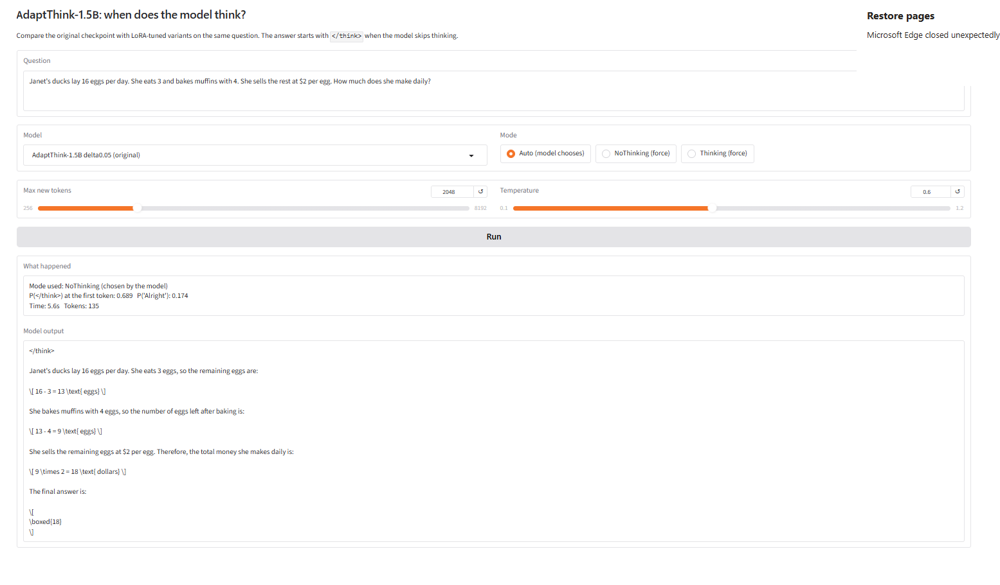

# AdaptThink on a single 20 GB GPU: reproduction, analysis, self-distillation and an online fallback

This repository is a copy of [THU-KEG/AdaptThink](https://github.com/THU-KEG/AdaptThink) (MIT License) plus my reproduction work. The authors' README follows below.

**What I did**

- Re-evaluated the authors' released checkpoints (no retraining; the paper's RL training needs 8 H800 GPUs) on GSM8K, MATH500 and AIME24 with one RTX A4500 (20 GB, WSL2).
- Analysed where the behaviour deviates (difficulty levels, implicit thinking, the effect of delta).
- Tried to improve the accuracy/length trade-off: three inference-time ideas (offline fallback to Thinking, threshold router, and an **online implicit-thinking fallback**) and a LoRA self-distillation study with design and hyperparameter ablations.
- Checked the paper's out-of-domain claim on MMLU.
- Result: the paper's claims reproduce, including on MMLU. The online fallback raises GSM8K accuracy by +1.0 point at unchanged length; no configuration is both shorter and at least as accurate on all three benchmarks (all results reported with intervals).

**Reproduction (AdaptThink-1.5B, delta 0.05; accuracy % / average length in tokens)**

| | GSM8K | MATH500 | AIME24 |
|---|---|---|---|
| Paper | 83.1 / 480 | 82.0 / 1782 | 31.0 / 6679 |
| This repo | 83.2 / 552 | 83.2 / 1796 | 30.2 / 6862 |
| Original R1-Distill-Qwen-1.5B (this repo) | 78.5 / 1022 | 81.0 / 4593 | 29.4 / 12242 |

**LoRA self-distillation, change vs the delta=0.05 checkpoint (accuracy points, length %)**

| | GSM8K | MATH500 | AIME24 |
|---|---|---|---|
| lr 1e-4 | -0.61, -22.6% | -0.45, -10.3% | -4.38, +0.7% |
| lr 3e-5 | -0.57, -18.1% | -0.45, -16.3% | -4.79, -4.9% |
| mode-preserving selection | +0.04, -11.6% | -0.40, -1.3% | -2.29, +7.2% |

The length saving comes from choosing NoThinking more often (not from shorter answers inside a mode), and on the hardest set it costs accuracy.

**Online implicit-thinking fallback, change vs the delta=0.05 checkpoint (accuracy points, length %)**

A NoThinking answer is stopped at its first "Wait"/"Alternatively" and the problem is re-solved in Thinking mode; the aborted tokens are counted in the length.

| | GSM8K | MATH500 | AIME24 |
|---|---|---|---|
| delta=0.05 + fallback | **+0.99 [+0.08, +1.88]**, +1.2% | +0.15, +14.9% | +1.88, +17.8% |
| LoRA lr 3e-5 + fallback | -0.42, -13.5% | -0.25, +2.3% | +0.21, +20.5% |

The fallback buys accuracy with tokens: it removes LoRA's AIME24 loss (-4.79 without it), and on GSM8K, where it rarely fires (2% of answers), it improves accuracy at no length cost.

**MMLU (out of domain, 2,000-question subset; accuracy % / length)**

| | Original | AdaptThink delta=0.05 | Change |
|---|---|---|---|
| Paper (full MMLU) | 35.7 / 1724 | 42.2 / 1055 | +6.5 points, -38.8% |
| This repo | 35.9 / 1589 | 40.1 / 992 | +4.2 points, -37.6% |

Details, intervals and ablations: [REPORT.md](REPORT.md).

**Demo app (Gradio)**



Run: `conda activate adapt_gui && python app/app.py`, then open http://localhost:7860 (setup: docs/SETUP_20GB_WSL2.md, section 6).

**Where things are**

- [REPORT.md](REPORT.md): technical report. [REPRODUCTION.md](REPRODUCTION.md): earlier reproduction notes.
- [docs/SETUP_20GB_WSL2.md](docs/SETUP_20GB_WSL2.md): environment and the fixes needed on a 20 GB card; [docs/demo_examples.md](docs/demo_examples.md): demo transcripts.
- `scripts/run_eval_local.sh`: single-GPU evaluation of released checkpoints; `scripts/run_*_chain.sh`: ablation and test runs.
- `analysis/`: standalone vLLM sampling and grading (`gen_natural.py`), data selection (`select_sft_data.py`), LoRA training (`sft_lora.py`), online fallback (`fallback_online.py`, tables: `fallback_table.py`), tables and analyses.
- `scripts/run_fallback_chain.sh`: runs the online-fallback and MMLU experiments; finished steps are skipped, so it can simply be restarted after an interruption. If a step fails with "GPU memory was not properly cleaned up", stop leftover processes with `pkill -f fallback_online.py` and rerun it.
- `results/`: tables and plots. `app/app.py`: Gradio demo (own conda env, see the setup notes).

**Limitations.** Released checkpoints were re-evaluated, not retrained; mostly one training or sampling seed; AIME24 has only 30 problems; MMLU was evaluated on a 2,000-question subset. All credit for the method goes to the paper's authors; please cite their paper (citation at the end of the original README).

---

## Original upstream README

# [EMNLP2025] AdaptThink: LLM Can Learn When to Think

<p align="center">
    🤗 <a href="https://huggingface.co/collections/THU-KEG/adaptthink-682a1059aa9f5102c4fa0470" target="_blank">HF Repo</a> • 📃 <a href="https://arxiv.org/abs/2505.13417" target="_blank">Paper</a>
</p>

## 🔍 Table of Contents
- [🤖️ AdaptThink](#adapt_think)
- [⚙️ Released Models](#model)
- [🔥 Training](#training)
- [📊 Evaluation](#evaluation)
- [🧐 Cases](#cases)
- [📝 Citation](#citation)

<a name="adapt_think"></a>
## 🤖️ AdaptThink
We present **AdapThink**, a novel reinforcement learning (RL) algorithm that enables reasoning models to adaptively choose between **Thinking** and **NoThinking** modes according to the difficulty of each input problem, thereby achieving automatic hybrid reasoning. Specifically, the model engages in thinking only when the problem is determined to be challenging; for other simple questions, it will bypass the thinking process and directly produce a concise final solution. This approach substantially reduces inference costs while further improving overall performance.


<a name="model"></a>
## ⚙️ Released Models

### All Available Datasets and Models
We apply the AdaptThink algorithm on DeepSeek-R1-Distill-Qwen-1.5B with $\delta$ from 0 to 0.1, and DeepSeek-R1-Distill-Qwen-7B with $\delta=0.05$. A larger $\large$ results in a higher proportion of NoThinking responses, which reduces more inference costs but also diminishes the resultant improvement in accuracy.

All the trained models are available on HuggingFace. 


| Name | HF Repo |
|---|---|
| AdaptThink-1.5B-delta0 | [🤗 HF Repo](https://huggingface.co/THU-KEG/AdaptThink-1.5B-delta0) |
| AdaptThink-1.5B-delta0.01 | [🤗 HF Repo](https://huggingface.co/THU-KEG/AdaptThink-1.5B-delta0.01) |
| AdaptThink-1.5B-delta0.02 | [🤗 HF Repo](https://huggingface.co/THU-KEG/AdaptThink-1.5B-delta0.02) |
| AdaptThink-1.5B-delta0.05 | [🤗 HF Repo](https://huggingface.co/THU-KEG/AdaptThink-1.5B-delta0.05) |
| AdaptThink-1.5B-delta0.075 | [🤗 HF Repo](https://huggingface.co/THU-KEG/AdaptThink-1.5B-delta0.075) |
| AdaptThink-1.5B-delta0.1 | [🤗 HF Repo](https://huggingface.co/THU-KEG/AdaptThink-1.5B-delta0.1) |
| AdaptThink-7B-delta0.05 | [🤗 HF Repo](https://huggingface.co/THU-KEG/AdaptThink-7B-delta0.05) |

<a name="training"></a>
## 🔥 Training

Our training code is based on [VeRL](https://github.com/volcengine/verl) framework.

### 1. Creating Environment
We use [vLLM](https://github.com/vllm-project/vllm) 0.8.2, which supports [flash-attention](https://github.com/Dao-AILab/flash-attention). 
```
conda create -n adapt_think python=3.10
pip install -r requirements.txt
pip install flash-attn --no-build-isolation
```

### 2. Check the chat template in HF models
After you download DeepSeek models, you should check `chat_template` in `tokenizer_config.json` to ensure the template ends with `<｜Assistant｜><think>\\n`, otherwise there will be bugs when running our code.

### 3. Pre-sampling from reference models
First, we need to pre-sample multiple responses from the reference model for each training problem to evaluate its instance-level accuracy. The sampling process will take several hours. For convenience, we have released our post-processed results in `./data/train/ref_results`, which can be directly used for training.
```
# Initialize VLLM server. You can start multiple servers to accelerate pre-sampling.
vllm serve deepseek-ai/DeepSeek-R1-Distill-Qwen-1.5B --served_model_name DeepSeek-R1-Distill-Qwen-1.5B --tensor_parallel_size 4

# Sampling 16 responses for each training problem. 
python src/presampling_ref_responses.py --K 16 --dataset_path ./data/train/deepscaler.json --model_name DeepSeek-R1-Distill-Qwen-1.5B --max_tokens 16384

# Postprocess to get instance-level accuracy
python src/postprocess_ref_results.py --input_path ./data/train/ref_presampling/DeepSeek-R1-Distill-Qwen-1.5B_deepscaler_n0_K16_len16384.json --output_path ./data/train/ref_results/DeepSeek-R1-Distill-Qwen-1.5B_deepscaler_K16_len16384.json
```

### 4. Preprocess training and test Datasets
```
bash scripts/preprocess_dataset.sh
```

### 5. Training
The training context size, batch size, and the learning rate are set to 16K, 128, and 2e-6, respectively. We train the models for 1 epoch, which is 314 steps in total. For the 1.5B model, we use one 8\*H800 node and cost about 32 hours. For the 7B model, we use four 8\*H800 nodes and cost about 28 hours. Finally, we select the checkpoints on 300 and 150 steps for the 1.5B and 7B models, respectively, where the models' accuracy and response lengths achieve a good balance.

To facilitate the training process, you can set a larger learning rate, such as 5e-5. However, it may make the training more unstable.
```
# 1.5b, single-node
bash scripts/run_adapt_think_1.5b_deepscaler_16k_delta0.05_btz128_lr2e-6.sh

# 7b, single-node
bash scripts/run_adapt_think_7b_deepscaler_16k_delta0.05_btz128_lr2e-6.sh

# 7b, multi-node
bash submit_mpi.sh scripts/run_adapt_think_7b_deepscaler_16k_delta0.05_btz128_lr2e-6_multinode.sh
```


<a name="evaluation"></a>
## 📊 Evaluation
During training, VeRL will automatically evaluate on you selected test sets for every `trainer.test_freq` step.

We also provide additional scripts for evaluation.

```
# convert checkpoint to HF model
bash scripts/convert_to_hf.sh

# eval
bash scripts/run_eval_verl_hf.sh
```

You can also evaluate downloaded HF models by running:
```
bash scripts/run_eval_hf.sh
```

We list our evaluation results as follows:
#### 1.  Comparison with existing methods for efficient reasoning on mathematics datasets


#### 2. Nothinking responses ratio and accuracy across different difficulty levels on MATH500


#### 3. Comparison of different $\delta$ values


#### 4. Evaluation results on MMLU


## 🧐 Cases
### Simple problem


### Difficult problem


<a name="citation"></a>
## 📝 Citation

If you find our work useful, please consider citing AdaptThink:

```
@article{zhang2025adapt_think,
  title = {AdaptThink: LLM Can Learn When to Think} 
  author={Jiajie Zhang and Nianyi Lin and Lei Hou and Ling Feng and Juanzi Li},
  journal={arXiv preprint arXiv: 2505.13417},
  url={https://arxiv.org/abs/2505.13417}
  year={2025}
}
```
