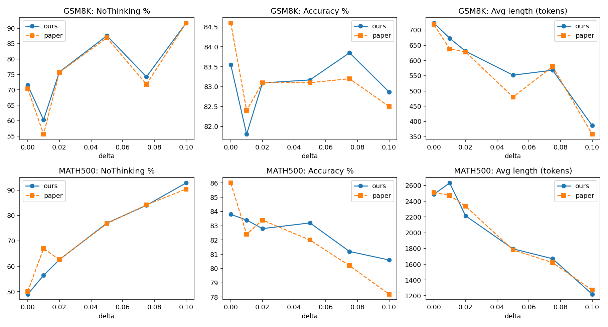
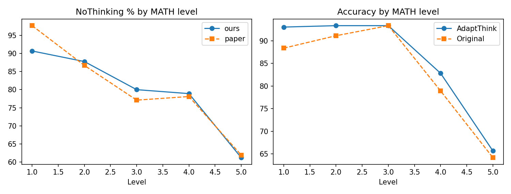
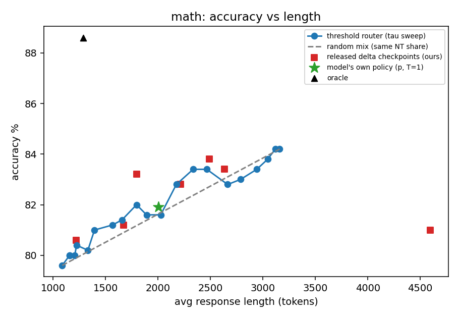
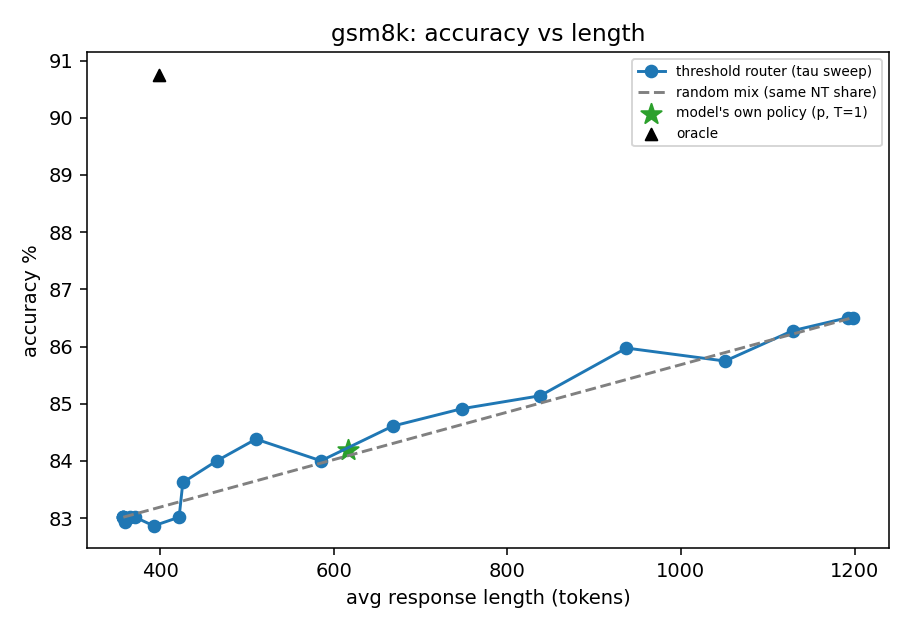
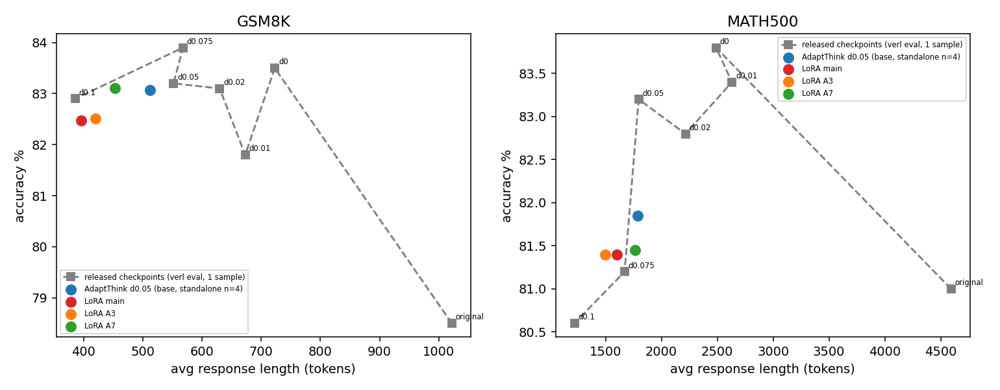

# Re-evaluating AdaptThink on a Single 20 GB GPU: Reproduction, Failure Analysis, Self-Distillation and an Online Implicit-Thinking Fallback

Author: Aqsa Abbasi. Setup notes: [docs/SETUP_20GB_WSL2.md](docs/SETUP_20GB_WSL2.md). Earlier reproduction notes: [REPRODUCTION.md](REPRODUCTION.md).

## 1. Introduction

Large reasoning models such as DeepSeek-R1 think at length even on easy problems, which raises latency and cost. I picked *AdaptThink: Reasoning Models Can Learn When to Think* (Zhang et al., EMNLP 2025, arXiv 2505.13417), which trains a reasoning model with reinforcement learning to choose per problem between a long Thinking mode and a short NoThinking mode. For DeepSeek-R1-Distill-Qwen-1.5B the paper reports a 53% shorter average response and a 2.4-point higher accuracy over three math benchmarks. Because the RL training needs 8 H800 GPUs for about 32 hours (1.5B model, per the paper), I did not retrain. I re-evaluated the authors' released checkpoints with the authors' code on one RTX A4500 (20 GB), compared every number with the paper, analysed where the behaviour deviates, and then tried to improve the accuracy/length trade-off with three inference-time modifications and with a LoRA self-distillation study that includes a design and hyperparameter ablation. The last modification, an online fallback that aborts a NoThinking answer as soon as it starts to "think" and re-solves the problem in Thinking mode, gave the one measurable improvement of this study (+1.0 accuracy point on GSM8K at unchanged length). I also checked the paper's out-of-domain claim on MMLU. My objective was to check the headline claims independently, to locate limitations, and to test which cheap modifications help and why.

## 2. Problem statement and contribution

**Observed limitations (from my own data).**

1. *Implicit thinking.* Responses in NoThinking mode can still contain reflection words. On AIME24, 117 of 217 NoThinking responses (54%) contain "Wait" or "Alternatively", and they are much less accurate than the rest (17.9% vs 35.0%). This is correlational.
2. *The trade-off is fixed at training time.* It is controlled by the training hyperparameter delta, so each point on the accuracy/length curve needs its own trained checkpoint (the authors released six for the 1.5B model).
3. *Reproduction gaps.* Mostly small, with a few visible ones (for example the MATH500 NoThinking share at delta=0.01: 56.4% vs 67.0% in the paper).

**Contribution.**

- Re-evaluated the released delta=0.05 checkpoint on GSM8K, MATH500 and AIME24 and all six released checkpoints on GSM8K and MATH500; all accuracies are within 2.4 points of the paper and the average length reduction is 50.3% (paper: 53.0%).
- Documented a single-GPU evaluation setup (the upstream scripts target 8 A100-80GB GPUs) and wrote standalone vLLM sampling and grading scripts with roughly three times the generation throughput of the upstream evaluation path on this machine (about 2,400 vs 700 generated tokens per second, estimated from run times).
- Added a level-wise MATH500 analysis and an implicit-thinking analysis.
- Tested two modifications that need no training and are evaluated offline (fallback to Thinking, threshold router): no gain beyond noise.
- Studied LoRA self-distillation on 693 self-generated examples with eight validation runs and test evaluation on three benchmarks. Length falls by 10-23% on GSM8K and MATH500 at similar accuracy, but accuracy drops by 4-5 points on AIME24.
- Showed with ablations and a length decomposition that the length saving comes from raising the NoThinking share, driven by the shortest-answer selection rule. A mode-preserving variant removes the NoThinking shift but also most of the length saving.
- Implemented and ran an online implicit-thinking fallback (Modification 4, Section 6.8): a NoThinking answer is stopped at its first "Wait"/"Alternatively" and the problem is re-solved in Thinking mode, with the aborted tokens counted in the length. On the released checkpoint it raises GSM8K accuracy by +0.99 points [+0.08, +1.88] at unchanged length (+1.2%) and raises accuracy on all three benchmarks, at a length cost of 15-18% on MATH500 and AIME24. On top of LoRA A3 it removes A3's AIME24 accuracy loss (26.5% to 31.5%; the released checkpoint has 31.2%) while GSM8K stays 13.5% shorter.
- Evaluated MMLU (out of domain, paper Table 4) on 2,000 questions: the released checkpoint is 4.2 points more accurate and 37.6% shorter than the original model (paper: +6.5 points, -38.8%). LoRA A3, trained on math only, makes MMLU answers 55% longer.
- No configuration is both shorter and at least as accurate as the released checkpoint on all three math benchmarks; the trade-offs are reported with intervals.

## 3. Method summary (the paper)

AdaptThink maximises the probability of the NoThinking mode subject to the accuracy not dropping below that of a reference model. The advantage is `1(first token = </think>) * delta + R(x, y) - mean reference reward(x)`, optimised with a PPO-style clipped loss without a KL term. To avoid a cold start, half of the sampled responses start with `</think>` and half with a thinking-start word ("Alright"). A larger delta gives more NoThinking responses and shorter outputs at the cost of a smaller accuracy gain.

## 4. Experimental setup

- Hardware and software: RTX A4500 (20 GB), WSL2 Ubuntu, Python 3.10, torch 2.6.0, vLLM 0.8.2 (pinned packages in `docs/pip_freeze_adapt_think.txt`).
- Models: DeepSeek-R1-Distill-Qwen-1.5B and the released AdaptThink-1.5B checkpoints (delta = 0, 0.01, 0.02, 0.05, 0.075, 0.1).
- Data: GSM8K (1319 problems), MATH500, AIME24 (30 problems, 16 samples each), and for the out-of-domain check 2,000 randomly chosen MMLU questions (seed 0, out of 14,042). For fine-tuning: 1000 problems from the DeepScaleR training set; a validation set of 200 other training problems that overlap with no test set.
- Decoding: 16K maximum response length, temperature 0.6, top-p 0.95. The authors' grader (`src/adapt_think_rm.py`) scores all answers.
- Two evaluation paths: the upstream verl evaluation (Sections 5.1 to 5.4, one sample per problem; 16 for AIME24) and my standalone vLLM evaluation (Section 6, four samples per problem; AIME24 one sample per row). The standalone baseline matches the verl one (for example AIME24: 31.2% vs 30.2%).
- Intervals are paired bootstrap over problems. Differences of a few points are within noise for single runs (about 1.7 points standard error on 500 problems), and AIME24 has only 30 problems.

## 5. Reproduction and analysis of the released checkpoints

### 5.1 Main results vs the paper (paper Table 1, 1.5B)

| Dataset | Model | Acc | Length | NoThinking % | Paper Acc | Paper Length | Paper NT % |
|---|---|---|---|---|---|---|---|
| GSM8K | Original | 78.5 | 1022 | 0.0 | 79.0 | 978 | 0.0 |
| GSM8K | AdaptThink-1.5B-d0.05 | 83.2 | 552 | 87.6 | 83.1 | 480 | 86.9 |
| MATH500 | Original | 81.0 | 4593 | 0.0 | 80.6 | 4887 | 0.0 |
| MATH500 | AdaptThink-1.5B-d0.05 | 83.2 | 1796 | 77.0 | 82.0 | 1782 | 76.8 |
| AIME24 | Original | 29.4 | 12242 | 0.0 | 29.4 | 12073 | 0.0 |
| AIME24 | AdaptThink-1.5B-d0.05 | 30.2 | 6862 | 45.2 | 31.0 | 6679 | 40.4 |

Accuracy is within 1.2 points of the paper on all three datasets. The largest length gap is GSM8K at delta=0.05 (552 vs 480 tokens); its cause is unknown.

### 5.2 Effect of delta (paper Table 2)

#### GSM8K

| delta | Acc (ours) | Acc (paper) | Length (ours) | Length (paper) | NoThinking % (ours) | NoThinking % (paper) |
|---|---|---|---|---|---|---|
| original | 78.5 | 79.0 | 1022 | 978 | 0.0 | 0.0 |
| 0 | 83.5 | 84.6 | 723 | 718 | 71.5 | 70.4 |
| 0.01 | 81.8 | 82.4 | 673 | 638 | 60.3 | 55.6 |
| 0.02 | 83.1 | 83.1 | 630 | 628 | 75.8 | 75.7 |
| 0.05 | 83.2 | 83.1 | 552 | 480 | 87.6 | 86.9 |
| 0.075 | 83.9 | 83.2 | 568 | 580 | 74.2 | 71.8 |
| 0.1 | 82.9 | 82.5 | 386 | 358 | 91.7 | 91.7 |

#### MATH500

| delta | Acc (ours) | Acc (paper) | Length (ours) | Length (paper) | NoThinking % (ours) | NoThinking % (paper) |
|---|---|---|---|---|---|---|
| original | 81.0 | 80.6 | 4593 | 4887 | 0.0 | 0.0 |
| 0 | 83.8 | 86.0 | 2489 | 2511 | 49.0 | 50.0 |
| 0.01 | 83.4 | 82.4 | 2631 | 2473 | 56.4 | 67.0 |
| 0.02 | 82.8 | 83.4 | 2215 | 2337 | 62.6 | 62.6 |
| 0.05 | 83.2 | 82.0 | 1796 | 1782 | 77.0 | 76.8 |
| 0.075 | 81.2 | 80.2 | 1670 | 1621 | 84.0 | 84.2 |
| 0.1 | 80.6 | 78.2 | 1220 | 1272 | 92.8 | 90.4 |

All 12 accuracy comparisons are within 2.4 points of the paper. A larger delta gives a higher NoThinking share and shorter answers; on MATH500 the accuracy gain over the original disappears at delta=0.1.

### 5.3 NoThinking share by MATH level, and keyword rate per dataset

#### MATH500 by difficulty level (AdaptThink-1.5B d0.05 vs original, ours vs paper)

Unmatched rows (should be 0): 0; difficulty values seen: [1.0, 2.0, 3.0, 4.0, 5.0]

| Level | n | NoThinking % (ours) | NoThinking % (paper Fig.5) | AdaptThink acc | Original acc | AdaptThink len | Original len |
|---|---|---|---|---|---|---|---|
| 1.0 | 43 | 90.7 | 97.7 | 93.0 | 88.4 | 426 | 2476 |
| 2.0 | 90 | 87.8 | 86.7 | 93.3 | 91.1 | 724 | 2742 |
| 3.0 | 105 | 80.0 | 77.1 | 93.3 | 93.3 | 1254 | 3570 |
| 4.0 | 128 | 78.9 | 78.1 | 82.8 | 78.9 | 1720 | 4591 |
| 5.0 | 134 | 61.2 | 61.9 | 65.7 | 64.2 | 3451 | 7319 |

#### Implicit thinking in AdaptThink NoThinking responses (keywords: Wait / Alternatively)

| Dataset | NoThinking responses | with keyword % | avg length (tokens) |
|---|---|---|---|
| GSM8K | 1155 | 2.9 | 436 |
| MATH500 | 385 | 7.3 | 953 |
| AIME24 | 217 | 53.9 | 4031 |
| pooled | 1757 | 10.2 | 993 |

Paper Table 3 (1.5B, AdaptThink NoThinking cases): 7.9% implicit thinking, avg length 826.
(Paper pools its own test cases, so compare with the pooled row only roughly.)

### 5.4 Implicit thinking inside NoThinking responses

| Dataset | NoThinking subset | n | acc % | avg len |
|---|---|---|---|---|
| GSM8K | with keyword | 34 | 47.1 | 3257 |
| GSM8K | no keyword | 1121 | 84.1 | 351 |
| GSM8K | (ref) Thinking mode | 164 | 84.1 | 1366 |
| MATH500 | with keyword | 28 | 35.7 | 3738 |
| MATH500 | no keyword | 357 | 87.4 | 735 |
| MATH500 | (ref) Thinking mode | 115 | 81.7 | 4616 |
| AIME24 | with keyword | 117 | 17.9 | 5750 |
| AIME24 | no keyword | 100 | 35.0 | 2019 |
| AIME24 | (ref) Thinking mode | 263 | 33.8 | 9197 |

## 6. Attempts to improve the trade-off

### 6.1 Modification 1: fall back to Thinking when implicit thinking is detected (offline estimate)

| Dataset | Policy | acc % | avg len | rows replaced |
|---|---|---|---|---|
| GSM8K | Original (Thinking) | 78.5 | 1022 | 0 |
| GSM8K | AdaptThink | 83.2 | 552 | 0 |
| GSM8K | AdaptThink + fallback (optimistic cost) | 82.9 | 563 | 34 |
| GSM8K | AdaptThink + fallback (conservative cost) | 82.9 | 647 | 34 |
| MATH500 | Original (Thinking) | 81.0 | 4593 | 0 |
| MATH500 | AdaptThink | 83.2 | 1796 | 0 |
| MATH500 | AdaptThink + fallback (optimistic cost) | 84.0 | 2110 | 28 |
| MATH500 | AdaptThink + fallback (conservative cost) | 84.0 | 2320 | 28 |
| AIME24 | Original (Thinking) | 29.4 | 12242 | 0 |
| AIME24 | AdaptThink | 30.2 | 6862 | 0 |
| AIME24 | AdaptThink + fallback (optimistic cost) | 32.6 | 8513 | 117 |
| AIME24 | AdaptThink + fallback (conservative cost) | 32.6 | 9915 | 117 |

The accuracy changes (-0.3, +0.8, +2.4 points) are within noise, and the paper's own delta=0 checkpoint reaches higher accuracy on MATH500 and AIME24. The estimate is optimistic. **No improvement demonstrated.**

### 6.2 Modification 2: threshold router on P(</think>)

The first-token probability `p` of `</think>` routes each problem: NoThinking if `p >= tau`, else Thinking. Both modes are generated once per problem and routers are evaluated offline, with random mixing at the same NoThinking share as control. Full tables: [MATH500](results/router_curve_math.md), [GSM8K](results/router_curve_gsm8k.md).

On GSM8K every threshold's 95% interval for the gain over random mixing includes 0 (best: +0.8 [-0.1, +1.6]). On MATH500 the best is +1.8 [+0.0, +3.4] at tau=0.65, picked from 21 thresholds, so it is optimistic. **No improvement demonstrated.**

### 6.3 Modification 3: LoRA self-distillation

Training data: for 1000 DeepScaleR problems I sampled 4 responses each from the released delta=0.05 checkpoint, kept responses that are correct, finished, at most 6144 tokens, and (default) free of "Wait"/"Alternatively" in NoThinking mode, and chose one per problem. The default rule takes the **shortest** response, which gives 693 examples with a 65.1% NoThinking share (all samples: 56.2%). LoRA (rank 16, alpha 32, all linear layers, dropout 0.05) is trained with loss on response tokens only (batch 8, cosine schedule, 2 epochs, lr 1e-4 for the main run). The learning rate and design ablations below were planned before seeing their results (A1 to A4); A5 to A7 were added afterwards and are marked post-hoc.

### 6.4 Validation ablation (200 problems, 4 samples each)

| run | acc % (diff [95% CI]) | avg len (diff [95% CI]) | NoThinking % (diff) | implicit % (diff) | final train loss |
|---|---|---|---|---|---|
| main (r16, lr1e-4, 2ep, shortest, filter) | 56.2 (-2.5 [-5.2, +0.2]) | 2621.2 (-262.2 [-412.5, -117.8]) | 69.2 (+9.9) | 9.9 (+1.9) | 0.096 |
| A1 random selection | 55.5 (-3.2 [-6.2, -0.4]) | 2945.3 (+61.8 [-90.8, +208.3]) | 62.2 (+2.9) | 9.6 (+1.6) | 0.105 |
| A2 no implicit filter | 55.1 (-3.6 [-6.6, -0.6]) | 2484.1 (-399.3 [-565.2, -230.9]) | 71.9 (+12.5) | 12.0 (+4.0) | 0.109 |
| A3 lr 3e-5 | 58.5 (-0.2 [-3.2, +2.8]) | 2618.0 (-265.4 [-427.7, -97.4]) | 68.8 (+9.4) | 11.2 (+3.2) | 0.103 |
| A4 1 epoch | 55.8 (-3.0 [-6.0, -0.1]) | 2568.5 (-315.0 [-516.0, -115.3]) | 72.0 (+12.6) | 10.1 (+2.1) | 0.110 |
| A5 lr 1e-5 (post-hoc) | 57.8 (-1.0 [-4.0, +2.0]) | 2932.9 (+49.5 [-105.4, +208.1]) | 56.6 (-2.8) | 5.9 (-2.1) | 0.108 |
| A6 lr 3e-5, seed 1 (post-hoc replicate of A3) | 58.2 (-0.5 [-3.2, +2.2]) | 2612.9 (-270.5 [-445.7, -94.7]) | 69.8 (+10.4) | 11.1 (+3.1) | 0.115 |
| A7 mode-preserving selection, lr 3e-5 (post-hoc) | 58.0 (-0.8 [-3.5, +2.0]) | 2848.1 (-35.4 [-203.7, +127.7]) | 60.4 (+1.0) | 9.6 (+1.6) | 0.110 |

Baseline (original delta=0.05) on the same 200 validation problems: acc 58.8%, len 2883, NoThinking 59.4%, implicit 8.0%.

- *Selection rule (A1 vs main):* random instead of shortest selection removes the length saving (+62 tokens) and most of the NoThinking shift (+2.9 vs +9.9 points). The shortest-answer rule drives both.
- *Learning rate:* all lr=1e-4 runs lose 2.5 to 3.6 points of accuracy; lr=3e-5 loses 0.2 to 0.5 (two seeds, A3 and A6) with the same length saving; lr=1e-5 leaves the length unchanged (A5).
- *Implicit filter (A2):* turning it off changes implicit thinking by about +2 points, within noise; the filter removes only 5% of the usable samples.
- *Mode-preserving selection (A7, post-hoc):* choosing, for every problem, the shortest correct response in the model's usual mode keeps the NoThinking share at the baseline level on the validation set (+1.0) but also removes the length saving.
- Validation has only 200 problems; one training seed per configuration except A3/A6; differences of 2 points between configurations are not resolved.

### 6.5 Test results

| Dataset | Model | Accuracy % (diff [95% CI]) | Avg length (diff, % [95% CI]) | NoThinking % (diff) | Cut at 16K % (diff) |
|---|---|---|---|---|---|
| GSM8K (1319 problems) | AdaptThink d0.05 (base) | 83.1 | 513 | 86.8 | 0.4 |
| GSM8K | LoRA main (lr 1e-4) | 82.5 (-0.61 [-1.63, +0.44]) | 397 (-116, -22.6% [-151, -81]) | 99.0 (+12.1) | 0.45 (+0.04) |
| GSM8K | LoRA A3 (lr 3e-5) | 82.5 (-0.57 [-1.50, +0.36]) | 420 (-93, -18.1% [-126, -60]) | 96.9 (+10.1) | 0.47 (+0.06) |
| GSM8K | LoRA A7 (mode-preserving, lr 3e-5) | 83.1 (+0.04 [-0.93, +0.95]) | 453 (-60, -11.6% [-96, -24]) | 93.1 (+6.3) | 0.55 (+0.13) |
| MATH500 (500 problems) | AdaptThink d0.05 (base) | 81.8 | 1786 | 77.2 | 1.4 |
| MATH500 | LoRA main (lr 1e-4) | 81.4 (-0.45 [-2.15, +1.25]) | 1602 (-185, -10.3% [-319, -55]) | 89.9 (+12.8) | 2.50 (+1.15) |
| MATH500 | LoRA A3 (lr 3e-5) | 81.4 (-0.45 [-2.05, +1.20]) | 1496 (-291, -16.3% [-417, -168]) | 91.2 (+14.1) | 1.80 (+0.45) |
| MATH500 | LoRA A7 (mode-preserving, lr 3e-5) | 81.5 (-0.40 [-1.95, +1.15]) | 1763 (-23, -1.3% [-152, +109]) | 82.0 (+4.8) | 2.40 (+1.05) |
| AIME24 (30 problems) | AdaptThink d0.05 (base) | 31.2 | 6948 | 43.5 | 12.7 |
| AIME24 | LoRA main (lr 1e-4) | 26.9 (-4.38 [-9.38, +0.62]) | 6994 (+45, +0.7% [-622, +788]) | 53.5 (+10.0) | 16.88 (+4.17) |
| AIME24 | LoRA A3 (lr 3e-5) | 26.5 (-4.79 [-9.58, -0.62]) | 6609 (-339, -4.9% [-1000, +297]) | 57.5 (+14.0) | 13.96 (+1.25) |
| AIME24 | LoRA A7 (mode-preserving, lr 3e-5) | 29.0 (-2.29 [-7.50, +2.29]) | 7451 (+503, +7.2% [-123, +1187]) | 43.5 (+0.0) | 18.96 (+6.25) |

The grey line is the released checkpoints (verl evaluation, one sample); the other points are my standalone evaluation with four samples per problem, so the comparison is approximate. Summary of the change relative to the delta=0.05 baseline:

| | GSM8K (acc, length) | MATH500 | AIME24 |
|---|---|---|---|
| main (lr 1e-4) | -0.61, -22.6% | -0.45, -10.3% | -4.38, +0.7% |
| A3 (lr 3e-5) | -0.57, -18.1% | -0.45, -16.3% | -4.79, -4.9% |
| A7 (mode-preserving) | +0.04, -11.6% | -0.40, -1.3% | -2.29, +7.2% |

On GSM8K and MATH500 the accuracy changes are within the noise (every interval includes 0). On AIME24 the main run and A3 lose 4.4 and 4.8 points (the A3 interval excludes 0, the main one barely includes it); A7 loses 2.3 points (interval includes 0) but its responses are 7.2% longer and 19.0% of them are cut at 16K (baseline: 12.7%).

### 6.6 NoThinking share by MATH level after fine-tuning

Unmatched rows: {'AdaptThink d0.05 (base)': 0, 'LoRA main': 0, 'LoRA A3 (lr 3e-5)': 0}

| Level | n problems | AdaptThink d0.05 (base): NT % / acc % / len | LoRA main: NT % / acc % / len | LoRA A3 (lr 3e-5): NT % / acc % / len |
|---|---|---|---|---|
| 1 | 43 | 95 / 91.3 / 452 | 99 / 95.3 / 373 | 100 / 95.3 / 344 |
| 2 | 90 | 90 / 89.7 / 677 | 99 / 89.2 / 494 | 98 / 90.0 / 547 |
| 3 | 105 | 78 / 93.3 / 1250 | 93 / 91.9 / 1065 | 95 / 91.7 / 941 |
| 4 | 128 | 78 / 81.6 / 1624 | 92 / 80.9 / 1520 | 92 / 80.3 / 1426 |
| 5 | 134 | 60 / 64.7 / 3534 | 76 / 64.0 / 3238 | 80 / 64.2 / 3004 |

The baseline chooses NoThinking for 95% of Level 1 and 60% of Level 5 problems; the LoRA models main and A3 reach 99-100% and 76-80%. Fine-tuning therefore weakens the difficulty-dependent choice that is AdaptThink's main property.

### 6.7 Where does the length saving come from?

The change in average length is split into a part due to the changed NoThinking share and a part due to changed lengths inside each mode.

| Dataset | Model | NT % | len in NT | len in Thinking | total change | from NT-share shift | from within-mode change |
|---|---|---|---|---|---|---|---|
| GSM8K | base | 86.8 | 365 | 1486 | | | |
| GSM8K | main | 99.0 | 380 | 1926 | -116 | -188 | +72 |
| GSM8K | A3 | 96.9 | 381 | 1623 | -93 | -125 | +32 |
| GSM8K | A7 | 93.1 | 357 | 1747 | -60 | -87 | +28 |
| MATH500 | base | 77.1 | 902 | 4773 | | | |
| MATH500 | main | 89.9 | 1022 | 6758 | -185 | -731 | +547 |
| MATH500 | A3 | 91.2 | 1029 | 6332 | -291 | -745 | +454 |
| MATH500 | A7 | 82.0 | 978 | 5329 | -23 | -209 | +186 |
| AIME24 | base | 43.5 | 4033 | 9196 | | | |
| AIME24 | main | 53.5 | 4384 | 10001 | +45 | -562 | +607 |
| AIME24 | A3 | 57.5 | 4266 | 9779 | -339 | -770 | +430 |
| AIME24 | A7 | 43.5 | 4748 | 9536 | +503 | -0 | +503 |

Caveat: the NoThinking subset is not the same set of problems before and after fine-tuning (easier problems move into it), so 'within-mode' also contains a composition effect.

The NoThinking-share term is non-positive in all nine cases and the within-mode term is positive in all nine, so the length saving comes from moving problems to NoThinking. The within-mode term is confounded by composition (easier problems leave the Thinking set). A comparison on the same problems and the same mode follows.

| Dataset | Model | Mode | problems with both | mean length change on the same problems [95% CI] |
|---|---|---|---|---|
| GSM8K | main | NoThinking | 1300 | -6 [-45, +31] |
| GSM8K | main | Thinking | 43 | +544 [-317, +1706] |
| GSM8K | A3 | NoThinking | 1300 | +2 [-33, +37] |
| GSM8K | A3 | Thinking | 108 | -165 [-632, +250] |
| GSM8K | A7 | NoThinking | 1297 | -13 [-47, +18] |
| GSM8K | A7 | Thinking | 183 | +198 [-153, +574] |
| MATH500 | main | NoThinking | 452 | +29 [-85, +148] |
| MATH500 | main | Thinking | 82 | +439 [-120, +1052] |
| MATH500 | A3 | NoThinking | 456 | +19 [-81, +120] |
| MATH500 | A3 | Thinking | 88 | +157 [-360, +732] |
| MATH500 | A7 | NoThinking | 449 | +48 [-56, +154] |
| MATH500 | A7 | Thinking | 137 | +344 [-186, +914] |
| AIME24 | main | NoThinking | 23 | +294 [-446, +1096] |
| AIME24 | main | Thinking | 25 | +1009 [-100, +2379] |
| AIME24 | A3 | NoThinking | 24 | +345 [-386, +1090] |
| AIME24 | A3 | Thinking | 25 | +193 [-550, +960] |
| AIME24 | A7 | NoThinking | 24 | +353 [-229, +965] |
| AIME24 | A7 | Thinking | 28 | +177 [-806, +1054] |

Only problems with at least one response in this mode both before and after are used, so the problem set is the same on both sides. This removes the composition effect of the decomposition table, but problems that switch mode are excluded.

**Reading.** On the same problems and in the same mode, NoThinking responses do not get shorter: the change is -13 to +48 tokens on GSM8K and MATH500 and every interval includes 0. Thinking-mode changes range from -165 to +544 tokens on GSM8K and MATH500, mostly positive, with intervals that include 0 and only 43 to 183 problems per cell. The AIME24 intervals are wide (23 to 28 problems per cell) and also include 0. This study therefore finds no evidence that fine-tuning teaches the model to write shorter responses within a mode; the length saving comes from the shift towards NoThinking. Problems that switch mode are not covered by this comparison.

### 6.8 Modification 4: online implicit-thinking fallback

**Motivation.** Two earlier findings point in opposite directions. LoRA A3 shortens responses on GSM8K and MATH500 at unchanged accuracy, but loses 4.8 points on AIME24, where it picks NoThinking more often (57.5% vs 43.5%). Section 5.4 shows that NoThinking responses containing "Wait"/"Alternatively" are far less accurate than the rest (AIME24: 17.9% vs 35.0%). The offline estimate in 6.1 replaced such responses only after they had finished, which is expensive because they average 3,000-5,700 tokens.

**Method** (`analysis/fallback_online.py`, run by `scripts/run_fallback_chain.sh`). The first token is sampled as usual, so the model still chooses its mode. In NoThinking mode, generation stops at the first "Wait" or "Alternatively", and the problem is then regenerated in Thinking mode with the paper's thinking prefix ("Alright"). The reported length counts **all** generated tokens, including the aborted attempt. Sampling settings, data, grader and the number of samples are the same as in Section 6.5, and the baseline is the same natural-sampling run of AdaptThink d0.05. The fallback is applied both to LoRA A3 and, as a control, to the released d0.05 checkpoint. The method, the trigger words and the runs were fixed before any test result was seen; the optional variant with an additional length cap was not run.

**Results** (full table with all columns: `results/fallback_online.md`)

| Dataset | Model | Accuracy % (diff [95% CI]) | Avg length incl. aborted tokens (diff, %) | NoThinking % | Fallback % | Cut at 16K % |
|---|---|---|---|---|---|---|
| GSM8K | AdaptThink d0.05 (base) | 83.1 | 513 | 86.8 | 0.0 | 0.4 |
| GSM8K | d0.05 + online fallback | **84.1 (+0.99 [+0.08, +1.88])** | 519 (+6, +1.2%) | 84.5 | 1.9 | 0.19 |
| GSM8K | LoRA A3 | 82.5 (-0.57 [-1.50, +0.36]) | 420 (-93, -18.1%) | 96.9 | 0.0 | 0.47 |
| GSM8K | LoRA A3 + online fallback | 82.7 (-0.42 [-1.38, +0.51]) | 443 (-69, -13.5%) | 95.0 | 2.0 | 0.51 |
| MATH500 | AdaptThink d0.05 (base) | 81.8 | 1786 | 77.2 | 0.0 | 1.4 |
| MATH500 | d0.05 + online fallback | 82.0 (+0.15 [-1.30, +1.70]) | 2053 (+266, +14.9%) | 70.1 | 6.0 | 1.85 |
| MATH500 | LoRA A3 | 81.4 (-0.45 [-2.05, +1.20]) | 1496 (-291, -16.3%) | 91.2 | 0.0 | 1.80 |
| MATH500 | LoRA A3 + online fallback | 81.6 (-0.25 [-2.00, +1.50]) | 1827 (+41, +2.3%) | 82.5 | 7.5 | 2.50 |
| AIME24 | AdaptThink d0.05 (base) | 31.2 | 6948 | 43.5 | 0.0 | 12.7 |
| AIME24 | d0.05 + online fallback | 33.1 (+1.88 [-2.92, +6.88]) | 8182 (+1234, +17.8%) | 19.0 | 22.1 | 13.75 |
| AIME24 | LoRA A3 | 26.5 (-4.79 [-9.58, -0.62]) | 6609 (-339, -4.9%) | 57.5 | 0.0 | 13.96 |
| AIME24 | LoRA A3 + online fallback | 31.5 (+0.21 [-5.00, +5.83]) | 8375 (+1426, +20.5%) | 25.6 | 29.2 | 17.92 |

Differences and intervals are paired bootstrap against AdaptThink d0.05 (base). NoThinking % counts a sample as NoThinking only if its final answer was produced in NoThinking mode, so it falls when the fallback fires.

Summary of the change relative to the d0.05 checkpoint (accuracy points, length %):

| | GSM8K | MATH500 | AIME24 |
|---|---|---|---|
| LoRA A3 (from 6.5) | -0.57, -18.1% | -0.45, -16.3% | -4.79, -4.9% |
| d0.05 + online fallback | **+0.99, +1.2%** | +0.15, +14.9% | +1.88, +17.8% |
| LoRA A3 + online fallback | -0.42, -13.5% | -0.25, +2.3% | +0.21, +20.5% |

**Reading.**

- *Released checkpoint + fallback.* Accuracy is higher on all three benchmarks. On GSM8K the gain is +0.99 points with an interval that excludes 0, at unchanged length (+6 tokens); the fallback fires on only 1.9% of samples there. This is the one accuracy gain over the released checkpoint in this study. On MATH500 and AIME24 the accuracy gains are within noise and the answers are 15-18% longer, because the fallback fires more often (6.0% and 22.1%) and the regenerated Thinking answers are long. Even so, the responses stay far shorter than those of the original model (Section 5.1: 4593 and 12242 tokens, measured with the verl evaluation, so the comparison is approximate).
- *LoRA A3 + fallback.* The fallback removes the AIME24 accuracy loss of A3 (26.5% to 31.5%, against 31.2% for the released checkpoint) and keeps most of the GSM8K saving (-13.5% length at unchanged accuracy). The price is length: the MATH500 saving disappears (+2.3%) and AIME24 answers are 20.5% longer. A3 chooses NoThinking more often, so more of its answers trigger the fallback (7.5% and 29.2% vs 6.0% and 22.1%).
- *Early abort.* The online fallback costs less than the offline estimate of 6.1, which had to finish each implicit-thinking answer before replacing it. On AIME24 the offline estimate needed +44% length (conservative cost, 9915 vs 6862 tokens) for +2.4 points; the online fallback needs +17.8% for +1.9 points. The two use different evaluation paths (6.1: verl, one sample; 6.8: standalone, four samples), so this is approximate.
- *Caution.* About a dozen accuracy comparisons are made in this section, so a single interval that just excludes 0 is weak evidence. The GSM8K gain matches the motivation (Section 5.4: GSM8K NoThinking answers with a keyword are 47.1% accurate against 84.1% for the rest), but it should be confirmed with another sampling seed.

The fallback therefore turns accuracy into length rather than improving both: it is useful where accuracy matters more than tokens, and on easy problems (GSM8K), where it rarely fires, it costs almost nothing.

### 6.9 Out-of-domain check: MMLU (paper Table 4)

2,000 randomly chosen MMLU questions (seed 0), one sample each, same grader and decoding as Section 6.5 (`results/mmlu.md`). Differences are paired bootstrap against AdaptThink d0.05.

| Model | Acc % (diff [95% CI]) | Length (diff, %) | NoThinking % | Cut at 16K % |
|---|---|---|---|---|
| DeepSeek-R1-Distill-Qwen-1.5B (original) | 35.9 (-4.30 [-6.70, -2.00]) | 1589 (+596, +60.1%) | 0.0 | 3.70 |
| AdaptThink d0.05 (base) | 40.1 | 992 | 14.7 | 1.9 |
| LoRA A3 | 40.2 (+0.05 [-2.25, +2.35]) | 1534 (+542, +54.6%) | 15.1 | 5.70 |
| LoRA A3 + online fallback | 42.0 (+1.90 [-0.35, +4.10]) | 1538 (+546, +55.0%) | 15.1 | 5.75 |

Comparison with the paper (Table 4, 1.5B, full MMLU):

| | Original acc / length | AdaptThink acc / length / NoThinking % | Change |
|---|---|---|---|
| Paper | 35.7 / 1724 | 42.2 / 1055 / 16.4% | +6.5 points, -38.8% length |
| This repo (2,000-question subset) | 35.9 / 1589 | 40.1 / 992 / 14.7% | +4.2 points, -37.6% length |

- The paper's out-of-domain claim reproduces: the released checkpoint is more accurate and about 38% shorter than the original model on MMLU, choosing NoThinking for about 15% of the questions. The accuracy gain is smaller than in the paper (+4.2 vs +6.5 points), on a 2,000-question subset.
- LoRA A3, fine-tuned on math answers only, does not generalise its length saving: on MMLU its answers are 55% longer than the released checkpoint's at the same NoThinking share, and 5.7% are cut at 16K (base: 1.9%).
- The fallback fires on only 0.1% of MMLU samples, so the +1.8-point difference between A3 and A3 + fallback is sampling noise between two runs, not an effect of the fallback.

## 7. Discussion and limitations

- This is a re-evaluation of released checkpoints plus LoRA fine-tuning on 693 self-generated examples; the RL training itself was not repeated, so training-time claims of the paper are untested here.
- Most configurations were trained with one seed. The only replicate (A6 of A3) agrees with A3.
- Validation has 200 problems and AIME24 has 30; the AIME24 conclusions rest on wide intervals. Several comparisons were examined, so isolated intervals that exclude 0 are weaker evidence than they look.
- The learning-rate choice (A3) was made on validation; A5 to A7 are post-hoc and were not used to select the test configurations except that A7 was added after seeing the AIME24 result for main and A3.
- The implicit-thinking check is a crude keyword match and the result is correlational.
- The fallback in 6.1 and the router in 6.2 are offline estimates from one sample per mode. The online fallback in 6.8 is a real generation run, but with one sampling seed.
- The online fallback uses a plain keyword trigger ("Wait", "Alternatively"). It also fires when these words occur in a non-reflective sense, and it misses reflection phrased differently.
- MMLU was evaluated on a 2,000-question random subset with one sample per question, not on all 14,042 questions as in the paper.
- Two evaluation paths (verl and standalone vLLM) are used; they agree on the baseline but are not identical.

## 8. Conclusion

The headline claims of AdaptThink reproduce closely on one 20 GB GPU: fewer tokens at equal or higher accuracy than the original model, on the three math benchmarks and out of domain on MMLU (+4.2 points, -37.6% length; paper: +6.5, -38.8%). The offline modifications did not improve on it. LoRA self-distillation with a shortest-answer rule saves 10-23% of the tokens on easy benchmarks with no detectable change in accuracy, but the saving comes from choosing NoThinking more often; on the hardest benchmark it costs 4-5 points of accuracy, and on MMLU the answers get 55% longer. The online implicit-thinking fallback, which stops a NoThinking answer at its first "Wait"/"Alternatively" and re-solves the problem in Thinking mode, is the one modification that measurably improved on the released checkpoint: +1.0 accuracy point on GSM8K at unchanged length, and higher (within-noise) accuracy on MATH500 and AIME24 at 15-18% more tokens. Combined with LoRA it removes LoRA's AIME24 accuracy loss. No configuration is both shorter and at least as accurate on all three benchmarks: the fallback buys accuracy with tokens and LoRA buys tokens with accuracy. A natural next step is to make the trade-off explicit in training, for example by giving zero reward to implicit-thinking NoThinking answers during RL, as the paper itself suggests.

## References

- Zhang, Lin, Hou, Feng, Li. AdaptThink: Reasoning Models Can Learn When to Think. arXiv:2505.13417, 2025. Code: https://github.com/THU-KEG/AdaptThink (MIT License).
- DeepSeek-AI. DeepSeek-R1: Incentivizing Reasoning Capability in LLMs via Reinforcement Learning. arXiv:2501.12948, 2025.
- Ma, He, Snell, Griggs, Min, Zaharia. Reasoning Models Can Be Effective Without Thinking. arXiv:2504.09858, 2025.
- Sheng et al. HybridFlow: A Flexible and Efficient RLHF Framework (VeRL). arXiv:2409.19256, 2024.
