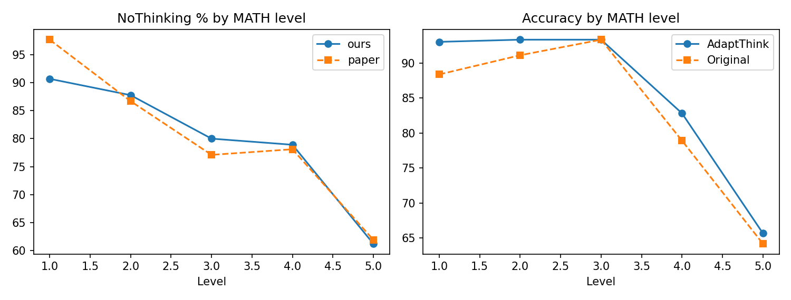

]633;E;cat <<'EOF'\x0a# AdaptThink: reproduction of the released checkpoint on a single 20 GB GPU\x0a\x0a**What this is:** a re-evaluation of the authors' released checkpoint (`THU-KEG/AdaptThink-1.5B-delta0.05`) against\x0a`DeepSeek-R1-Distill-Qwen-1.5B`, on GSM8K, MATH500 and AIME24, using the authors' code.\x0a**What this is not:** a retraining. The RL training was not re-run (the paper used 8x H800).\x0a\x0aPaper: Zhang et al., *AdaptThink: Reasoning Models Can Learn When to Think* (arXiv 2505.13417).\x0aSetup details and fixes: [docs/SETUP_20GB_WSL2.md](docs/SETUP_20GB_WSL2.md).\x0a\x0aSettings: 16K max response, temperature 0.6, top-p 0.95, one sample per problem (AIME24: 16 samples per problem).\x0aSingle run, so small differences from the paper are expected (sampling noise\x3b AIME24 has only 30 problems).\x0a\x0a## 1. Baseline vs paper (Table 1, 1.5B)\x0a\x0aEOF\x0a;17a661b3-54c0-4377-8d55-7255fa3fbd87]633;C# AdaptThink: reproduction of the released checkpoint on a single 20 GB GPU

**What this is:** a re-evaluation of the authors' released checkpoint (`THU-KEG/AdaptThink-1.5B-delta0.05`) against
`DeepSeek-R1-Distill-Qwen-1.5B`, on GSM8K, MATH500 and AIME24, using the authors' code.
**What this is not:** a retraining. The RL training was not re-run (the paper used 8x H800).

Paper: Zhang et al., *AdaptThink: Reasoning Models Can Learn When to Think* (arXiv 2505.13417).
Setup details and fixes: [docs/SETUP_20GB_WSL2.md](docs/SETUP_20GB_WSL2.md).

Settings: 16K max response, temperature 0.6, top-p 0.95, one sample per problem (AIME24: 16 samples per problem).
Single run, so small differences from the paper are expected (sampling noise; AIME24 has only 30 problems).

## 1. Baseline vs paper (Table 1, 1.5B)

| Dataset | Model | Acc | Length | NoThinking % | Paper Acc | Paper Length | Paper NT % |
|---|---|---|---|---|---|---|---|
| GSM8K | Original | 78.5 | 1022 | 0.0 | 79.0 | 978 | 0.0 |
| GSM8K | AdaptThink-1.5B-d0.05 | 83.2 | 552 | 87.6 | 83.1 | 480 | 86.9 |
| MATH500 | Original | 81.0 | 4593 | 0.0 | 80.6 | 4887 | 0.0 |
| MATH500 | AdaptThink-1.5B-d0.05 | 83.2 | 1796 | 77.0 | 82.0 | 1782 | 76.8 |
| AIME24 | Original | 29.4 | 12242 | 0.0 | 29.4 | 12073 | 0.0 |
| AIME24 | AdaptThink-1.5B-d0.05 | 30.2 | 6862 | 45.2 | 31.0 | 6679 | 40.4 |

Accuracy is within 1.2 points of the paper on all three datasets. Average length reduction is 50.3% (paper: 53.0%).
Largest gaps: GSM8K AdaptThink length (552 vs 480) and AIME24 NoThinking ratio (45.2% vs 40.4%).

## 2. NoThinking share and accuracy by MATH level

## MATH500 by difficulty level (AdaptThink-1.5B d0.05 vs original, ours vs paper)

Unmatched rows (should be 0): 0; difficulty values seen: [1.0, 2.0, 3.0, 4.0, 5.0]

| Level | n | NoThinking % (ours) | NoThinking % (paper Fig.5) | AdaptThink acc | Original acc | AdaptThink len | Original len |
|---|---|---|---|---|---|---|---|
| 1.0 | 43 | 90.7 | 97.7 | 93.0 | 88.4 | 426 | 2476 |
| 2.0 | 90 | 87.8 | 86.7 | 93.3 | 91.1 | 724 | 2742 |
| 3.0 | 105 | 80.0 | 77.1 | 93.3 | 93.3 | 1254 | 3570 |
| 4.0 | 128 | 78.9 | 78.1 | 82.8 | 78.9 | 1720 | 4591 |
| 5.0 | 134 | 61.2 | 61.9 | 65.7 | 64.2 | 3451 | 7319 |

## Implicit thinking in AdaptThink NoThinking responses (keywords: Wait / Alternatively)

| Dataset | NoThinking responses | with keyword % | avg length (tokens) |
|---|---|---|---|
| GSM8K | 1155 | 2.9 | 436 |
| MATH500 | 385 | 7.3 | 953 |
| AIME24 | 217 | 53.9 | 4031 |
| pooled | 1757 | 10.2 | 993 |

Paper Table 3 (1.5B, AdaptThink NoThinking cases): 7.9% implicit thinking, avg length 826.
(Paper pools its own test cases, so compare with the pooled row only roughly.)

## 3. Implicit thinking inside NoThinking responses

"Implicit thinking" = the response contains `Wait` or `Alternatively` after `</think>` (a crude keyword check).

| Dataset | NoThinking subset | n | acc % | avg len |
|---|---|---|---|---|
| GSM8K | with keyword | 34 | 47.1 | 3257 |
| GSM8K | no keyword | 1121 | 84.1 | 351 |
| GSM8K | (ref) Thinking mode | 164 | 84.1 | 1366 |
| MATH500 | with keyword | 28 | 35.7 | 3738 |
| MATH500 | no keyword | 357 | 87.4 | 735 |
| MATH500 | (ref) Thinking mode | 115 | 81.7 | 4616 |
| AIME24 | with keyword | 117 | 17.9 | 5750 |
| AIME24 | no keyword | 100 | 35.0 | 2019 |
| AIME24 | (ref) Thinking mode | 263 | 33.8 | 9197 |

On AIME24, 117 of 217 NoThinking responses contain these keywords, and they are much less accurate (17.9% vs 35.0%).
This is correlational: those responses are likely on harder problems.

## 4. Tested idea: fall back to Thinking when implicit thinking is detected

Estimate from saved predictions: replace each flagged response by the original model's mean accuracy/length on that problem.
"Optimistic" assumes the flag is caught immediately; "conservative" also pays for the full discarded NoThinking response.

| Dataset | Policy | acc % | avg len | rows replaced |
|---|---|---|---|---|
| GSM8K | Original (Thinking) | 78.5 | 1022 | 0 |
| GSM8K | AdaptThink | 83.2 | 552 | 0 |
| GSM8K | AdaptThink + fallback (optimistic cost) | 82.9 | 563 | 34 |
| GSM8K | AdaptThink + fallback (conservative cost) | 82.9 | 647 | 34 |
| MATH500 | Original (Thinking) | 81.0 | 4593 | 0 |
| MATH500 | AdaptThink | 83.2 | 1796 | 0 |
| MATH500 | AdaptThink + fallback (optimistic cost) | 84.0 | 2110 | 28 |
| MATH500 | AdaptThink + fallback (conservative cost) | 84.0 | 2320 | 28 |
| AIME24 | Original (Thinking) | 29.4 | 12242 | 0 |
| AIME24 | AdaptThink | 30.2 | 6862 | 0 |
| AIME24 | AdaptThink + fallback (optimistic cost) | 32.6 | 8513 | 117 |
| AIME24 | AdaptThink + fallback (conservative cost) | 32.6 | 9915 | 117 |

Result: accuracy changes of -0.3 (GSM8K), +0.8 (MATH500) and +2.4 (AIME24) points, at +2% to +44% more tokens.
These are within sampling noise for 1 sample/problem, and the paper's own delta=0 training run (MATH500 86.0%, AIME24 34.8%)
reaches higher accuracy than this estimate. **The idea is not supported by this data.**
The estimate is optimistic (it uses mean original accuracy, not an actual restarted sample).

## Limitations

- Re-evaluation of a released checkpoint, no retraining.
- One sample per problem (16 for AIME24); no confidence intervals computed.
- The keyword heuristic for implicit thinking is crude.
- The fallback result is an offline estimate, not an implemented decoding policy.

## Files

- `scripts/run_eval_local.sh`: single-GPU evaluation script
- `analysis/`: level analysis, implicit-thinking subsets, fallback estimate
- `results/`: tables, plot, logs, `metrics/` (per-run `overall_metrics.json`)

Upstream code: https://github.com/THU-KEG/AdaptThink (MIT License, retained in `LICENSE`).
